# spacegear: logo guidelines (compact)

> Identity only. Written for anyone who places the logo. More dos than don'ts; when in doubt, use the files as they are.
> This is the repo copy of the identity kit's guidelines. Paths below point at this repo: the masters are in `svg/` next to this file, the site's web files in `public/` and `src/app/`. The kit's printable page and PDF are not committed (they embed fonts and images).

## 1. The logo
- **Idea:** a planet split along the dash, its two halves sliding apart: the moment a business shifts gear. Space and gear in one shape. The cut is the old dash, kept as structure. Like an *s*, the symbol reads the same upside down.
- **Versions:** horizontal (primary) · stacked · symbol · wordmark · small cut (16–24 px). Orange on Night is the primary version.
- **Files:** `svg/*.svg` for screens and as print masters (a printer makes PDF/EPS from them) · the site's web files for browsers (see §11). PNG exports for office tools are not committed; make them from the SVG masters.

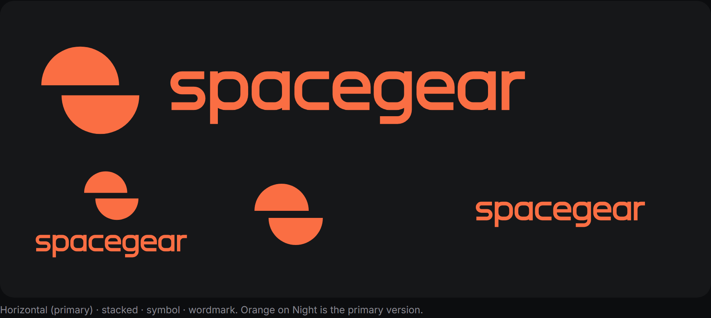

| Version | Use it for |
|---|---|
| Horizontal (primary) | Site header, documents, slides, most uses |
| Stacked | Square or tall spaces: avatars with room, title slides, merchandise |
| Symbol | App icons, favicons, avatars, the footer badge core, loaders |
| Wordmark | Where the symbol already appears close by |
| Small cut | The symbol at 16–24 px only (wider cut and shift on whole pixels) |

## 2. Construction
- **Symbol:** one planet of radius R, cut along its equator. The cut is 0.26 R. The halves slide 0.26 R each way in opposite directions, so the symbol is point-symmetric.
- **Horizontal logo:** one half-planet = one x-height (R = X). The cut runs on the line of the e's crossbar. The name starts 0.75 X after the symbol.
- **Stacked logo:** R = 1.30 X. The symbol sits 0.90 X above the x-height, centred on the name.
- **The name** is drawn, not typed: lowercase on a rounded-rectangle system (x-height 100, stems 20, corner radius 30 on the centre line, vertical cuts). Each letter is its own shape.

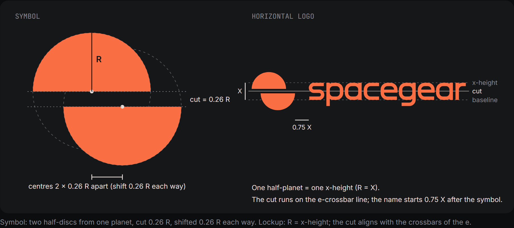

## 3. Clear space
Keep a clear zone of **1 X** on every side, where X is the x-height of the name (= the height of one half of the planet in the horizontal logo). The zone scales with the logo; never use a fixed distance. In the nav pill, the pill's padding is the minimum.

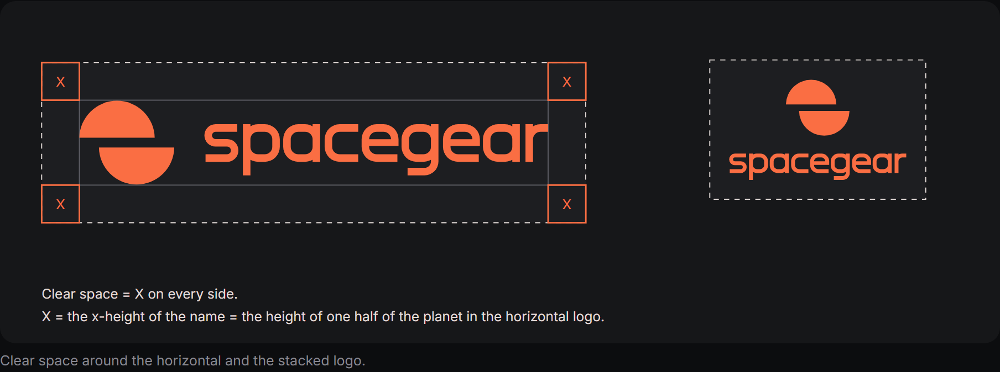

## 4. Minimum size
| Version | Screen | Print |
|---|---|---|
| Horizontal | symbol 20 px tall (logo ≈ 110 px wide) | 25 mm wide |
| Stacked | 80 px wide | 18 mm wide |
| Wordmark | 80 px wide (x-height ≈ 9 px) | 18 mm wide |
| Symbol | 25 px; use the small cut from 24 px down to 16 px | 6 mm (small cut down to 4 mm) |

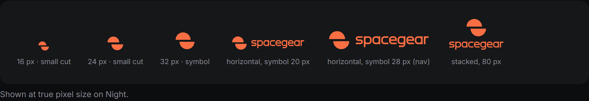

## 5. Colour
Screen values are the masters. CMYK and Pantone are starting points: confirm them on a press proof against a physical Pantone guide.

| Name | HEX | RGB | CMYK | Pantone (approx.) | Use |
|---|---|---|---|---|---|
| Flame | `#fa6e43` | 250 110 67 | 0 · 68 · 74 · 0 | ≈ 1645 C | The signature: the logo, key accents. ~5–10 % of a layout. |
| Ash | `#e3dbd8` | 227 219 216 | 0 · 4 · 5 · 11 | ≈ Warm Gray 1 C | Light text and the two-tone half on dark. The site's `ink` token. |
| Night | `#161719` | 22 23 25 | 72 · 62 · 56 · 82 (rich black) | ≈ Neutral Black C | The page. Also the Ink for light grounds. |
| Deep | `#08080b` | 8 8 11 | 75 · 65 · 60 · 90 (rich black) | ≈ Black 6 C | The scene behind the Earth; the deepest ground. |

**Ink** is Night (`#161719`) used on light grounds: one dark value keeps the palette to four colours.

| Pair | Contrast | Result |
|---|---|---|
| Flame on Night #161719 | 6.3 : 1 | pass |
| Flame on Deep #08080b | 7.0 : 1 | pass |
| Flame on the footer #0c0d0f | 6.8 : 1 | pass |
| Ash on Night | 13.2 : 1 | pass |
| Ink (Night) on white | 17.9 : 1 | pass |
| Flame on white | 2.85 : 1 | below 3 : 1, so the wordmark goes in Ink |

**Logo colourways:**
- `-flame` (primary): flame symbol and name, for Night, Deep, the footer, the nav pill, and dark space or ocean in photos.
- `-white`: for dark grounds and dark photos, thinned 0.6 % against irradiation.
- `-ink`: flame symbol with an ink name, for white and light grounds.
- `-black`: one-colour print.
- `-twilight`: an Ash top half over a Flame bottom half, for **dark grounds only**: never on light or bright photos, and never below 32 px.

## 6. Approved backgrounds
- **The hero rule:** over the Earth, keep the logo on the nav pill (or another dark surface). Straight on the image, use only the orange logo, and only over dark space or ocean: over bright land and cloud it weakens, and white and two-tone versions vanish.
- **The light-ground rule:** on white and light grounds, the name goes in Ink (Flame on white is 2.85:1). The orange symbol may stay as the accent.

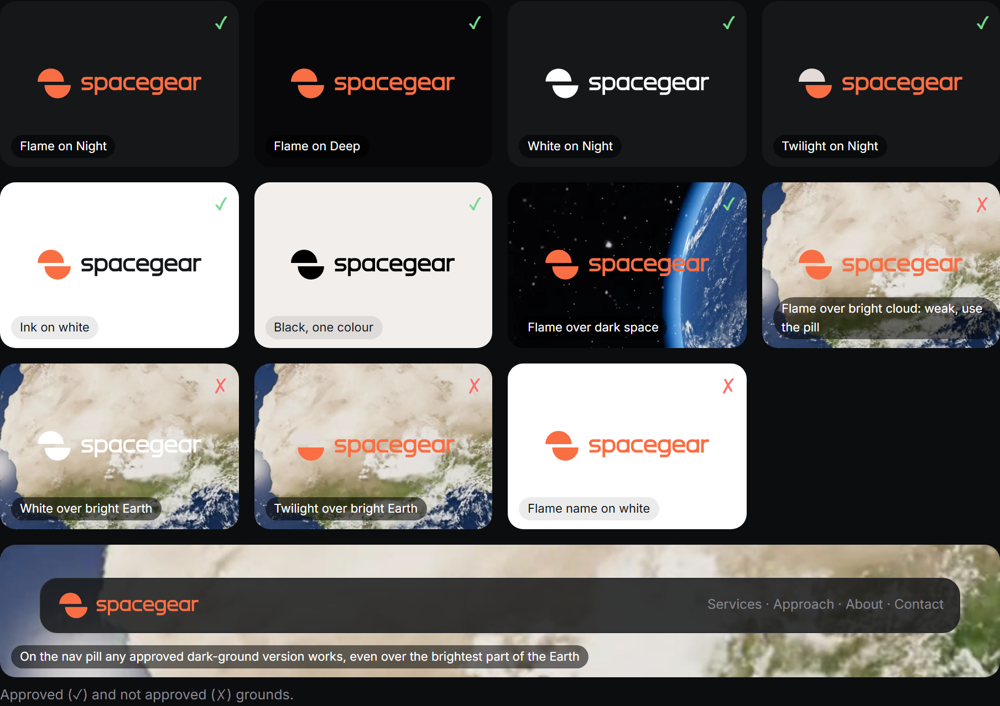

## 7. Typography
- **The logo is drawn, not typed.** Never recreate it by typing "spacegear" in any font, and never bring back the dash (*space—gear*).
- **Interface type:**
  - **Inter** for headings and text (headings −0.04 em, as on the site);
  - **JetBrains Mono** for labels and eyebrows.

  Both are under the SIL Open Font License (`public/licenses/fonts.txt`). The logo itself needs no font licence.

## 8. The ™
Show the ™ **once, on the footer's giant wordmark**, and nowhere else: not in the nav, the favicon or the OG image. It is a claim, not protection.
- Run a professional trademark search before relying on it.
- Switch to ® only after registration. The site's honesty check already rejects ® until then.
- The ™ is a drawn glyph (`spacegear-tm-*.svg`).

## 9. Motion
- **The halves slide like the site's curtain.** They enter from opposite sides along the cut and lock into the resting logo in 0.6–0.9 s on the site's ease. The resting frame is always the master.
- **The name rises letter by letter** in the footer as the curtain opens (one element per glyph, ~55 ms stagger). It may lean a few pixels away from the pointer.
- **Never** spin the symbol, morph the halves, animate the colour, or loop it as decoration.
- **Reduced motion:** under `prefers-reduced-motion: reduce`, show the resting logo with no slide and no rise.

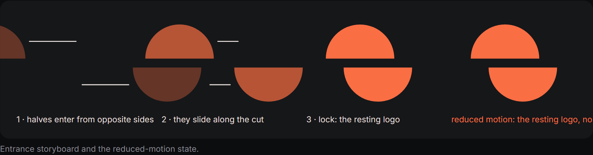

## 10. Don'ts
| Example | Rule |
|---|---|
| 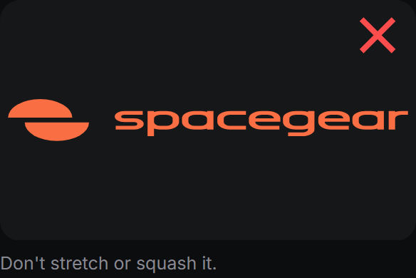 | Don't stretch or squash it. |
| 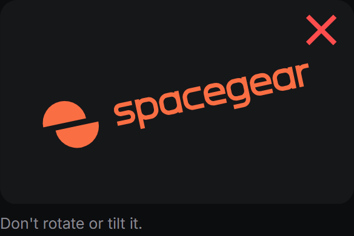 | Don't rotate or tilt it. |
| 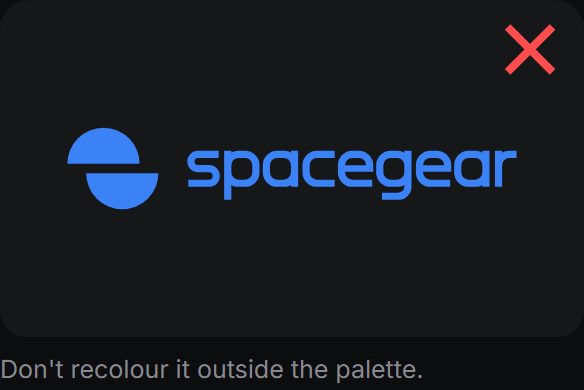 | Don't recolour it outside the palette. |
| 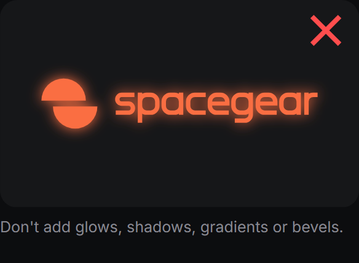 | Don't add glows, shadows, gradients or bevels. |
| 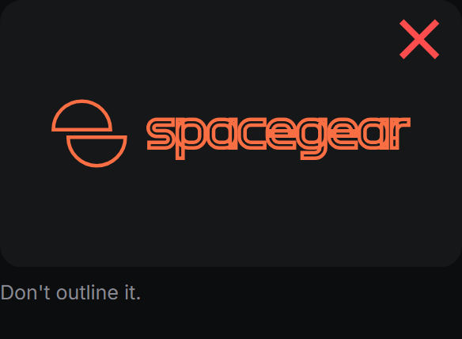 | Don't outline it. |
| 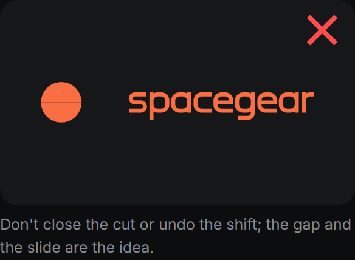 | Don't close the cut or undo the shift; the gap and the slide are the idea. |
| 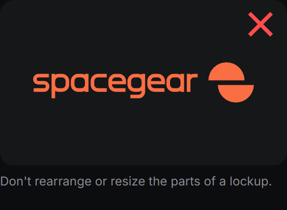 | Don't rearrange or resize the parts of a lockup. |
| 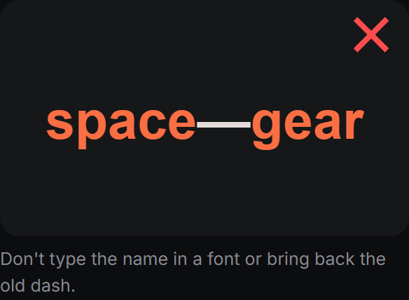 | Don't type the name in a font or bring back the old dash. |
| 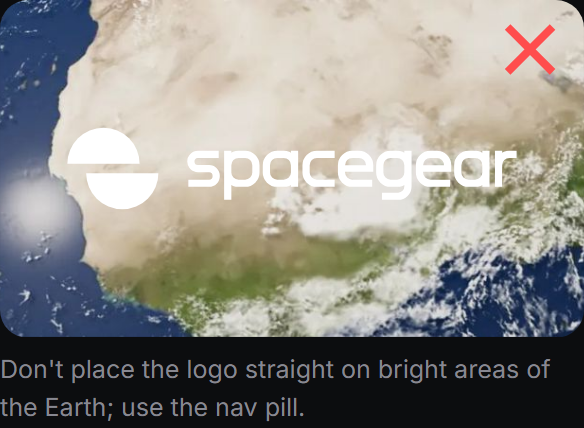 | Don't place the logo straight on bright areas of the Earth; use the nav pill. |
| 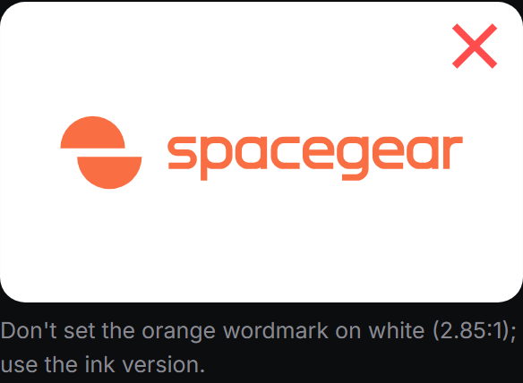 | Don't set the orange wordmark on white (2.85:1); use the ink version. |

## 11. Files
| File | Use |
|---|---|
| `svg/spacegear-logo-horizontal-{flame,white,twilight}.svg` | Primary logo on dark grounds (white is thinned for reversal; twilight on dark only). |
| `svg/spacegear-logo-horizontal-{ink,black}.svg` | Light grounds and one-colour print. |
| `svg/spacegear-logo-stacked-*.svg` | Square and tall formats: avatars, slides, merchandise. |
| `svg/spacegear-symbol-*.svg` | The symbol alone, 256 canvas (25 px and up). |
| `svg/spacegear-symbol-small-*.svg` | The 16–24 px cut (favicon, tiny UI). |
| `svg/spacegear-wordmark-*.svg` | The name alone, where the symbol already appears nearby. |
| `svg/spacegear-tm-*.svg` | The drawn ™, for the footer wordmark only. |
| `public/icon.svg`, `src/app/favicon.ico`, `public/apple-icon.png` | Favicon (the small cut on a 16 px grid; the .ico holds 16, 32 and 48 px) and the 180 px Apple icon. |
| `public/icon-192.png`, `public/icon-512.png`, `public/icon-maskable-512.png`, `src/app/manifest.ts` | The web manifest and its icons (the maskable one keeps the symbol inside the safe zone). |
| `public/seo/og.png` (source: `og.svg` here) | 1200 × 630 link preview, shapes only. |
| `src/components/Brand.tsx`, `src/components/Wordmark.tsx` | The React components (inline SVG, currentColor, per-glyph hooks). |

Masters are outlined SVG: no live text, strokes, filters, rasters or transforms. Never send a PNG to a printer.

## 12. Contact
Questions about usage: the site owner. Master files: `svg/` next to this file.
