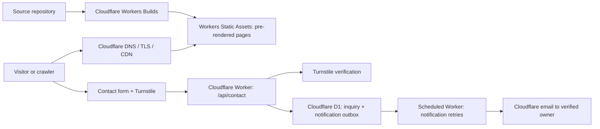

# Spacegear website revival: design and delivery brief

Status: proposed design, based on the local source audit and live site inspection. Requested scope for this stage: analyze first and produce a comprehensive revival plan. No new production website has been built or deployed.

Evidence: [site audit](../../audits/2026-10-20-spacegear-site-audit.md). Execution: [implementation plan](../plans/2026-10-20-spacegear-revival.md).

## 1. Intent and fixed requirements

Transform the current Platform product website into the website of **Spacegear**, a digital transformation consultancy and technology-enabled strategy and delivery partner. Explain how Spacegear applies digital systems, AI, machine learning and deep learning to real business problems and carries the work from assessment into production and adoption.

User requirements:

- Replace the old company and product identity throughout the website.
- Preserve the existing aesthetic and animations.
- Host and run the website exclusively on Cloudflare.
- Optimize speed, technical SEO and visibility in AI-assisted search.
- Analyze the existing site before planning the rebuild.
- Clone the intended repository when its source URL is available.

Planning assumptions, not confirmed company facts: spelling **Spacegear**; English first; B2B founders, business leaders, operations leaders and technology/data leaders; lead generation as the primary business goal; no country/industry specialization claimed until supplied. The final domain, legal entity, real team, contact details and client evidence remain owner inputs. These do not prevent building a local preview but must be resolved or omitted before publication.

Avoid: retaining SaaS pricing under a consultancy logo; substituting unsupported success statistics; publishing generated portraits as actual staff; keyword-stuffed copy; promising search rankings or AI citations; adding a chatbot simply because the company offers AI services.

## 2. Positioning and message

Working positioning statement:

> Spacegear is a digital transformation and AI consultancy that connects business strategy with hands-on delivery. We help organizations identify valuable opportunities, build practical digital and AI solutions, and embed them into everyday operations.

Proposed hero:

- Eyebrow: **Digital transformation. AI. Strategy through delivery.**
- Headline: **Turn digital ambition into business advantage.**
- Supporting copy: **Spacegear helps you modernize operations, apply AI where it creates value, and build the systems your business needs to grow—from the first roadmap to production and adoption.**
- Primary CTA: **Discuss your transformation** → `/contact/`.
- Secondary CTA: **Explore our services** → `/services/`.
- Scroll statement: **We connect strategy, technology and people to make transformation work in the real world.**

Keep “digital transformation consultancy” visible near the headline and in the page title/description. The headline can be expressive because surrounding text explicitly names the business.

Voice: direct, technically credible, business-oriented, specific about deliverables. Describe opportunities as opportunities, not guaranteed outcomes. Deep learning belongs in the relevant capability and use-case explanations; do not imply every business problem needs a neural network.

## 3. Service architecture

| Service and URL | Buyer problem | Concrete scope and deliverables |
|---|---|---|
| Digital Transformation Strategy — `/services/digital-transformation/` | Unclear priorities and disconnected initiatives | Current-state assessment, process mapping, opportunity prioritization, business case, implementation roadmap and operating model |
| AI Strategy & Enablement — `/services/ai-strategy/` | AI interest without a viable adoption plan | Readiness assessment, use-case selection, data requirements, evaluation criteria, governance, pilot plan and team enablement |
| Applied AI & Deep Learning — `/services/applied-ai/` | Unstructured information, prediction or perception problems | Document intelligence, retrieval, forecasting or computer vision where justified; baseline comparisons, prototype, evaluation, deployment and monitoring plan |
| Automation & Systems Integration — `/services/automation-integration/` | Repetitive work and fragmented systems | Workflow redesign, integrations, human review points, exception handling, operational dashboards and documentation |
| Digital Product & Platform Delivery — `/services/product-delivery/` | Strategy cannot reach usable production software | Discovery, UX, architecture, implementation, testing, rollout, handover and iteration |

These are proposed offers. Each page must state who it helps, typical starting conditions, what Spacegear delivers, the delivery process, limitations/dependencies, relevant examples, FAQs and the next step. Do not claim certifications, partner status, delivery times or commercial terms that have not been established.

Engagement cards replace subscription pricing:

1. **Assess & prioritize** — agree a problem, baseline and roadmap.
2. **Validate & build** — prove a use case, then deliver a production-ready system.
3. **Embed & improve** — support adoption, measurement and continuing improvement.

Use “Scope agreed around your objectives” instead of invented package prices. Duration and pricing can be added later when the actual offers are known.

## 4. Information architecture and launch content

Primary navigation: **Services · Approach · About · Insights**, with **Discuss your transformation** as the persistent CTA. Add **Work** only when publishable evidence exists. The mobile menu must expose the same destinations.

| Route | Purpose | Launch rule |
|---|---|---|
| `/` | Explain Spacegear and guide buyers to a relevant service/contact | Required |
| `/services/` and the five service detail routes above | Distinct buyer intents and indexable service information | Required; substantive, distinct copy |
| `/approach/` | Explain assess → prioritize → validate → deliver → adopt | Required; owners, deliverables and decision gates |
| `/about/` | Company purpose, working principles and verified people/facts | Required; omit unknown biographies/location claims |
| `/contact/` | Qualified inquiry form and verified contact route | Required |
| `/insights/`, `/insights/[slug]/` | Original, useful explanations linked to services | Launch with two reviewed articles; never publish placeholder authors or dates |
| `/privacy/`, `/terms/` | Actual website/data-handling terms | Required before collecting inquiries; owner supplies or approves final factual/legal content |
| `/work/`, `/work/[slug]/` | Genuine case studies | Conditional; if none are verified, omit routes, navigation and sitemap entries |
| `/404.html` | Helpful missing-page response | Required; real HTTP 404 |

Minimum editorial set: two substantial articles, “How to prioritize AI use cases for business value” and “From an AI pilot to production: what has to change.” More content after launch: transformation roadmap, integration readiness, deep learning versus simpler approaches, data quality and AI evaluation. These are editorial hypotheses, not verified keyword-volume findings. Confirm target market, language, search intent and competing results before freezing content priorities.

Article template: short direct answer; clear sections; practical examples; explicit assumptions and limitations; source references; genuine author/reviewer when known; actual publication/update dates; related services; one useful CTA. No automated bulk content program.

Case-study template, when evidence exists: business context, baseline, intervention, delivery role, timeframe, result measurement and approval. If confidentiality applies, publish an approved anonymized study. Otherwise use clearly labeled example use cases on service pages, never disguise them as client work.

## 5. Homepage transformation map

| Existing component | Proposed Spacegear content | Visual treatment |
|---|---|---|
| `Nav.tsx` / shared `ui.tsx` brand labels | Spacegear wordmark and consultancy navigation | Keep floating glass/charcoal navigation and orange accent |
| `OrbitalCinematic.tsx` | New hero and transformation statement | Retain orbital storytelling and scroll choreography; immediate readable copy |
| `Work.tsx` | “Where we create value” use-case cards | Retain bento composition and card stack; examples labeled as such |
| `Services.tsx` | Five service pillars | Retain expanding panels; each service links to a full page |
| `Process.tsx` | Assess, prioritize, validate, deliver, adopt | Retain animated sequence; replace automated infrastructure claims |
| `Analytics.tsx` | “How we measure progress” | Keep dashboard aesthetic; show criteria such as cycle time, quality and adoption without fabricated results |
| `Pricing.tsx` | Three engagement models | Keep card styling; remove billing toggle, seats and subscription prices |
| `Faq.tsx` | Consultancy questions | Retain accordion styling; answer ownership, starting point, data readiness, integration and delivery |
| `Team.tsx` | “How we work together” principles, unless real team material is supplied | Keep editorial layout; use abstract visuals instead of fictitious staff |
| `Testimonials.tsx` | Verified quotes only | Omit by default until evidence is supplied |
| `Labs.tsx` | Spacegear Insights | Retain article cards; replace placeholder expertise claims |
| `Footer.tsx` | Real sitemap, identity, contact and policies | Preserve curtain reveal and badge; remove inert newsletter and dead links |

Preferred home order: hero → value areas → services → approach → measurement → engagements → company principles/proof → insights → FAQ → consultation CTA/footer. Keep content concise on home; move detail to linked pages.

## 6. Visual and motion contract

Retain charcoal `#161719`, orange `#fa6e43`, warm light text, Inter/monospace typographic pairing, rounded panels, thin borders and celestial imagery. Improve muted text where measured contrast fails. Replace all logos, brand badges, favicon and social imagery; maintain required third-party license notices outside marketing identity.

- Initial HTML contains visible headline, service descriptions, links and CTA. No opacity-zero dependency for essential copy; JavaScript and WebGL are enhancements.
- Keep a static poster behind the desktop scene until it is ready. Do not remount the hero copy or change its reserved geometry when the scene loads.
- Retain the cinematic desktop sequence for capable devices. Dynamically import 3D only after the primary content is usable; respect reduced motion and available data-saving signals. Never branch by crawler user agent.
- Narrow screens use the existing static cosmic direction with lightweight optional motion; no GLB request. Reduced motion means no continuous particle, marquee, rotating badge or scroll-scrub animation.
- Pause decorative rendering when offscreen or the tab is hidden. Cap rendering resolution; optimize textures/mesh and verify visual fidelity before replacing assets.
- Reserve image and canvas dimensions; favor opacity/transform over animated layout. Keep hover effects and text/card reveals that fit the performance budget.
- Links and controls remain operable by keyboard; menus expose expanded state, support Escape and return focus. Focused elements must not be hidden by the sticky navigation. Carousels must have a static/reduced-motion presentation and accessible controls.
- Test no JavaScript, failed WebGL, failed model loading, reduced motion, 320–390 px mobile widths, 768 px tablet, 1024 px breakpoint and 1440 px desktop, plus landscape/200% zoom.

## 7. Cloudflare-only architecture

**Recommended:** retain Next.js, add `output: 'export'`, generate route HTML at build time, and deploy `out/` with Cloudflare Workers Static Assets. One Worker entry handles only dynamic paths. Repository content is compiled during Cloudflare Workers Builds. Git hosting and search verification tools are development/discovery services, not alternative application hosts.

| Need | Cloudflare implementation | Scope |
|---|---|---|
| Hosting, TLS, edge caching | Workers Static Assets, Cloudflare DNS/CDN | Required |
| Form endpoint | Worker, same origin `/api/contact` | Required; not a Next.js POST handler in a static export |
| Inquiry storage | D1 with migrations and an outbox | Required; authoritative capture before success |
| Abuse protection | Turnstile + endpoint rate limiting | Required; server verification and clear retry behavior |
| Internal notifications | Cloudflare email; verify account eligibility, sender and owner destination | Required for launch unless owner deliberately operates from D1; never fake delivery |
| Media | Optimized static files initially; R2 if media volume warrants it | R2 optional, not a place for unnecessary public source masters |
| Image variants | Build-time Sharp initially; Cloudflare Images if editorial needs justify it | No third-party image CDN |
| Observability | Workers logs and Cloudflare Web Analytics; first-party vitals ingestion if needed | Avoid logging inquiry text/emails or tokens |
| Content | Versioned repository data/Markdown; rebuild on publish | No external CMS required |
| Optional future AI experience | Workers AI + Vectorize/AI Search over approved public content | Separate later phase; zero dependency for core pages or SEO |

Do not add KV, Queues, Durable Objects or an AI gateway without a workload that needs them. The initial outbox can use D1 and a scheduled Worker. Cloudflare is the host of the **website**; this does not imply all Spacegear client AI/deep-learning projects can be trained or delivered entirely on Workers AI.

Alternatives considered: OpenNext on Workers is appropriate if runtime rendering/Server Actions become necessary; it adds adapter/runtime complexity this marketing site does not currently need. Rewriting in Astro could reduce baseline JavaScript, but introduces migration work and risks changing the existing motion. Preserve Next.js first and revisit only if measured performance cannot meet the agreed budget.

Export/routing contract: canonical paths end in `/`; Next.js `trailingSlash: true`; dynamic routes enumerate publishable slugs with `generateStaticParams` and `dynamicParams = false`. Cloudflare uses `html_handling: 'force-trailing-slash'`, `not_found_handling: '404-page'`, and Worker-first routing for `/api/*` and explicit legacy paths that need handler redirects. Do not use a universal SPA fallback. Configure redirects/security headers at Cloudflare or in emitted `_redirects`/`_headers`, not Next.js server configuration. Apply equivalent headers directly to Worker responses.

## 8. Conversion and inquiry contract

Primary CTA consistently opens `/contact/`, optionally preselecting a service. Fields: name, work email, company (optional), service interest (optional), and a short description of the challenge. Explain how submitted information will be used and link the real privacy policy. No newsletter enrollment or file uploads at launch.

`POST /api/contact` accepts a bounded JSON payload and a Turnstile token; only the configured site origin is accepted. Validate server-side, verify token success/hostname/action, rate-limit, and atomically store the inquiry and notification outbox row. Generate an idempotency key per submission attempt; the same key/body cannot create duplicate inquiries. Return success only after durable storage, even if notification is still pending.

Display specific field errors; preserve typed values after transient failure; allow retry with a fresh challenge token. Generic server errors must not leak internal data. Worker responses are `no-store`. Email failure must not erase a captured inquiry; use bounded retries and visible operational failure status. Send to the fixed verified owner address only, not a user-controlled recipient. No visitor autoresponder or bulk newsletter depends on Cloudflare beta availability at launch.

Keep inquiry data private; no public listing API. Provisional retention is 90 days for unqualified inquiries, configurable and confirmed before launch; do not delete data during this planning stage. Exclude personal data from analytics and logs. The website must accurately describe the final data practices.

## 9. Technical SEO and migration

- One final canonical production origin, confirmed by the owner. Build-time validation refuses a production release using the old Vercel domain, localhost or a placeholder domain.
- Unique titles, descriptions, canonical URL, Open Graph/Twitter metadata and a clear H1 for every indexable page. Service names appear naturally in page copy and links.
- Generate sitemap from the same published content source as routes; include only canonical 200 URLs and genuine modification dates. Robots permits intended public pages; private API/admin routes are not indexed. Staging is protected and carries `noindex` responses.
- Use semantic HTML and real `<a href>` links. Put important answers in visible text, not only images, canvas, animation or a chatbot.
- Add Organization/WebSite, Service, Article and BreadcrumbList JSON-LD only when supported by visible, verified facts. No Product/SoftwareApplication markup for consulting services; no invented reviews or AggregateRating. FAQ content is useful, but do not promise FAQ rich results.
- Audit all current paths. Map old routes to a new route only where the content is meaningfully equivalent; retired fictional products otherwise return 404/410. Never redirect every missing URL to home. Old hash links such as `/#pricing` cannot be handled by server redirects: update links and provide a temporary same-page anchor if compatibility is needed.
- If the old deployment/domain is controlled and has useful indexed URLs, configure one-hop permanent redirects to the equivalent production URLs and maintain them. If it is only a template preview, deindex/retire it when authorized. Do not claim old-domain search equity will transfer without that control.
- Check final HTTP status, canonical destination, redirect chain, sitemap, indexability and social unfurls on Cloudflare. Verify Search Console and Bing Webmaster Tools and submit the sitemap once the domain exists.

## 10. AI-assisted search visibility

The objective is understandable, retrievable, credible content. There is no universal “AI SEO score.” Google states that its AI features use normal SEO foundations and require no special AI schema/text files; inclusion is not guaranteed. [Google guidance](https://developers.google.com/search/docs/appearance/ai-features)

Maintain consistent Spacegear name, description, real people and confirmed company facts across the site and genuine external profiles. Write direct answers to buyer questions; link explanations to services, examples and sources. Publish original expertise and actual project evidence rather than generic summaries.

At Cloudflare, distinguish search/indexing and user-requested agent access from model training. Audit robots, WAF, managed bot settings and challenges together; a permissive robots file alone does not prove access. Start from the goal of allowing legitimate public search/retrieval, while keeping abuse protection and private paths protected. Training policy is a separate owner choice. Avoid user-agent spoofing as proof of verified crawler access. [Cloudflare classifications](https://developers.cloudflare.com/bots/concepts/bot/)

An optional `llms.txt` may summarize published public material if a real consuming tool needs it. It is not a launch gate or a replacement for normal content. Do not serve a hidden, keyword-heavy alternate page to AI agents. Track actual referred visits, qualified inquiries and sampled citations, clearly distinguishing these from guaranteed visibility.

## 11. Performance and quality acceptance

Target **100** in each Lighthouse category. For a release decision, use these explicit gates, and record any exception rather than calling an unmeasured or lower score “maximum.”

| Measure | Release target | Evidence |
|---|---|---|
| Lighthouse SEO | 100 | All representative templates, mobile and desktop |
| Lighthouse accessibility | 100 automated score plus manual keyboard/zoom/contrast checks | Automated score alone is not WCAG conformance |
| Lighthouse best practices | 100 | No unresolved material findings |
| Lighthouse performance | 100 target; at least 95 median with no run below 90 | Three cold runs per representative template/profile; pinned tool version and settings |
| LCP | ≤2.5 s field p75; aim ≤2.0 s in the defined lab profile | Real-user field data after launch; synthetic result labeled separately |
| INP | ≤200 ms field p75 | Interaction/RUM measurement, not a Lighthouse navigation score |
| CLS | ≤0.1 field p75; aim ≤0.05 in lab | Include hero hydration, fonts and below-fold interactions |
| Broken/placeholder internal links | 0 | Crawl all published routes |
| Indexable routes with unique canonical/title/description | 100% | Inspect exported HTML and production HTTP |
| Structured data | 0 validation errors; all claims match visible content | Schema validator and supported rich-result tests |
| Brand cleanup | 0 unintended old-brand/product/company references in rendered site/assets/metadata | Source/content and browser audit |
| Contact | Durable capture, no duplicate retry, recoverable failure, verified owner workflow | Local integration tests and authorized deployment smoke test |

Initial engineering budgets, to be checked on the first production build: compressed initial JS ≤200 KiB per marketing route before optional 3D; initial home transfer ≤750 KiB before 3D; mobile hero poster ≤150 KiB; desktop 3D enhancement including model/textures/extra code ≤3 MiB total, model aim ≤2 MiB. Count automatic prefetching and shared runtime bytes. If a budget cannot be met without losing essential appearance, measure and present the tradeoff explicitly; do not hide downloads just to improve a score.

Measure the home, service index, one service detail, approach, about, contact, insight index and one insight article; add work templates if published. Run against a production build on Cloudflare with normal animation behavior and the same content for crawlers and people. Also test genuine mobile/reduced-motion fallbacks. Lighthouse is a diagnostic, not a ranking guarantee. Field Core Web Vitals require real traffic; an unavailable CrUX report is not a pass. [Core Web Vitals definitions](https://web.dev/articles/vitals)

## 12. Delivery sequence and owner inputs

1. Preserve the current source; resolve source repository and working branch; finalize factual company inputs.
2. Implement the content model, page structure and complete identity replacement.
3. Adapt the visual sections and motion contract; preserve desktop/mobile reference comparisons.
4. Add the Cloudflare export/Worker stack and functional contact journey.
5. Complete metadata, schema, routes, image/model optimization and accessibility.
6. Validate preview, launch on the confirmed domain and monitor actual performance/discovery.

Planning estimate: roughly 10–15 focused engineering/editorial working days for one implementer once content and account inputs are available, plus observation after launch. This is a provisional effort estimate, not a committed delivery date. Content preparation and model optimization are the largest uncertainties.

Owner inputs needed before public launch: source repository URL; exact brand spelling and final domain; legal/company/contact details; real people and evidence that may be published; target market/language priorities; Cloudflare project/domain/email eligibility and a verified owner destination. No secrets belong in this document or chat. Use Cockpit owner-command workflows for credentialed/deployment actions after the project is registered.

Launch rollback: retain the previous known-good Worker/assets version, use additive D1 migrations, and never roll back by deleting captured inquiries. Post-launch checks: immediate HTTP/form/robots smoke tests; first-week crawl/error review; review field vitals after sufficient data accumulates, normally across a 28-day reporting window. Track qualified inquiry rate and content usefulness alongside technical scores.
